# MyEkskul
### Sistem Pemetaan Minat dan Rekomendasi Ekstrakurikuler Siswa Berbasis Mobile

MyEkskul merupakan aplikasi berbasis mobile yang dikembangkan menggunakan Flutter untuk membantu siswa mengenal kegiatan ekstrakurikuler di sekolah. Aplikasi ini dirancang untuk menyajikan informasi ekstrakurikuler dan mendukung pengembangan sistem pemetaan minat serta rekomendasi kegiatan sesuai minat siswa.

## 📖 Deskripsi Proyek

Aplikasi MyEkskul dikembangkan sebagai proyek mata kuliah dengan teknologi Flutter dan Dart pada sisi aplikasi mobile, serta PHP dan MySQL untuk backend dan pengelolaan data.

Proyek ini dikembangkan secara bertahap. Fitur yang sudah tersedia dan fitur yang masih dalam pengembangan perlu dibedakan sesuai hasil implementasi dan pengujian aplikasi.

## ✨ Fitur Aplikasi

Fitur yang tersedia pada implementasi aplikasi meliputi:

- Menampilkan daftar ekstrakurikuler.
- Mencari ekstrakurikuler berdasarkan informasi yang tersedia.
- Menampilkan detail ekstrakurikuler.
- Menampilkan dan mengelola profil pengguna.
- Memilih foto profil dari galeri perangkat.
- Menghapus foto profil yang dipilih.
- Menghubungkan aplikasi dengan backend melalui API.

**Pengembangan selanjutnya:**

- Menyelesaikan kuesioner pemetaan minat siswa.
- Mengembangkan rekomendasi ekstrakurikuler berdasarkan hasil pemetaan minat.
- Menyempurnakan proses pendaftaran ekstrakurikuler.
- Melakukan pengujian dan penyempurnaan integrasi aplikasi dengan backend.

> Catatan: sesuaikan daftar fitur di atas dengan fitur yang benar-benar sudah berjalan saat aplikasi diuji.

## 🛠️ Teknologi yang Digunakan

| Teknologi | Kegunaan |
|---|---|
| Flutter | Pengembangan antarmuka aplikasi mobile |
| Dart | Bahasa pemrograman aplikasi Flutter |
| PHP | Pengembangan backend dan API |
| MySQL | Penyimpanan data |
| XAMPP | Menjalankan server lokal dan database |
| Git dan GitHub | Pengelolaan versi dan penyimpanan kode sumber |

## 📋 Persyaratan

Sebelum menjalankan proyek, siapkan:

- Flutter SDK dan Dart.
- Android Studio atau editor kode yang mendukung Flutter.
- Android Emulator atau perangkat Android.
- XAMPP dengan Apache dan MySQL.
- File backend/API MyEkskul dan database yang sesuai.

## 🚀 Cara Menjalankan Aplikasi

### 1. Clone repositori


git clone https://github.com/diniartika2402-spec/MyEkskul.git
cd MyEkskul
```

### 2. Instal dependensi Flutter


flutter pub get

### 3. Jalankan backend

1. Jalankan Apache dan MySQL melalui XAMPP.
2. Tempatkan folder backend/API di direktori web server XAMPP sesuai struktur proyek.
3. Buat dan impor database MySQL yang dibutuhkan.
4. Periksa konfigurasi koneksi database pada backend PHP.
5. Pastikan endpoint API dapat diakses sebelum menjalankan aplikasi.

### 4. Konfigurasi alamat API

Pada Android Emulator, alamat IP host komputer yang umum digunakan untuk mengakses server lokal adalah:


http://10.0.2.2/


Sesuaikan alamat tersebut dengan lokasi folder API dan konfigurasi proyek. Contohnya, jika folder API bernama `myekskul_api`, endpoint dapat menggunakan pola:


http://10.0.2.2/myekskul_api/


Nama folder, nama endpoint, dan alamat API harus disesuaikan dengan backend yang benar-benar digunakan oleh proyek.

### 5. Jalankan aplikasi

Pastikan emulator atau perangkat Android sudah terhubung, kemudian jalankan:


flutter run


## 📸 Screenshot Aplikasi

Tambahkan screenshot dari aplikasi yang benar-benar sudah dijalankan dan diuji. Simpan gambar di folder `screenshots/` pada direktori utama proyek.

Contoh struktur folder:


MyEkskul/
├── screenshots/
│   ├── login.png
│   ├── dashboard.png
│   ├── ekstrakurikuler.png
│   ├── detail_ekstrakurikuler.png
│   └── profil.png
├── lib/
├── android/
├── pubspec.yaml
├── README.md
└── AI_DECLARATION.md


Setelah gambar tersedia, tampilkan di bagian ini menggunakan Markdown:


### Halaman Login
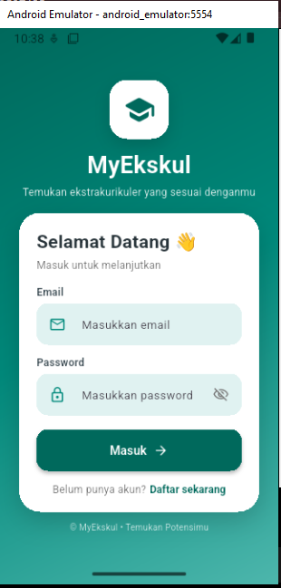

### Halaman Dashboard


### Halaman Ekstrakurikuler


### Halaman Detail Ekstrakurikuler


### Halaman Profil
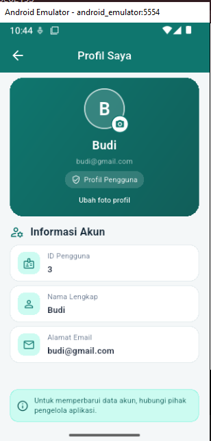


Hapus bagian gambar yang belum tersedia dan tambahkan hanya screenshot yang sesuai dengan tampilan aplikasi.

## 📁 Struktur Proyek


MyEkskul/
├── android/
├── lib/
│   └── pages/
│       └── user/
├── linux/
├── macos/
├── windows/
├── pubspec.yaml
├── pubspec.lock
├── README.md
└── AI_DECLARATION.md


Struktur di atas merupakan gambaran umum. Struktur aktual dapat berbeda mengikuti susunan file pada repositori.

## 👩‍💻 Identitas Pengembang

- **Nama:** Dini Artika Rahmawati
- **NPM:** 2413025014
- **Program Studi:** Pendidikan Teknologi Informasi
- **Universitas:** Universitas Lampung
- **Proyek:** Sistem Pemetaan Minat dan Rekomendasi Ekstrakurikuler Siswa Berbasis Mobile


## 📌 Status Pengembangan

MyEkskul masih dikembangkan secara bertahap. Penyempurnaan fitur pemetaan minat, rekomendasi ekstrakurikuler, dan integrasi backend dilakukan berdasarkan kebutuhan proyek dan hasil pengujian.

## 📄 Lisensi

Proyek ini dikembangkan untuk keperluan pembelajaran dan tugas akademik.

## Screenshot Aplikasi MyEkskul

### 1. Halaman Login


### 2. Halaman Registrasi
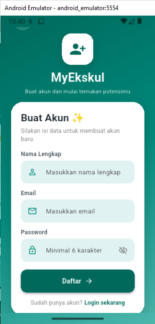

### 3. Dashboard Siswa


### 4. Halaman Profil


### 5. Halaman Kuesioner


### 6. Halaman Kuis
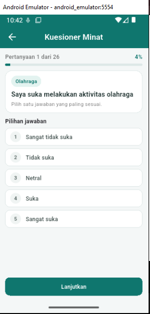

### 7. Hasil Pemetaan dan Rekomendasi
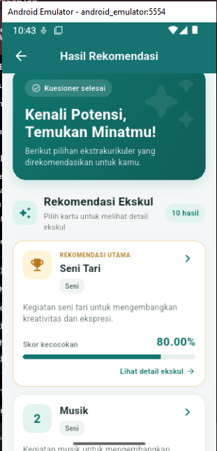

### 8. Daftar Ekstrakurikuler
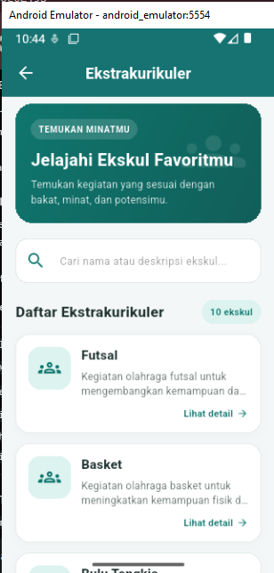

### 9. Detail Ekstrakurikuler
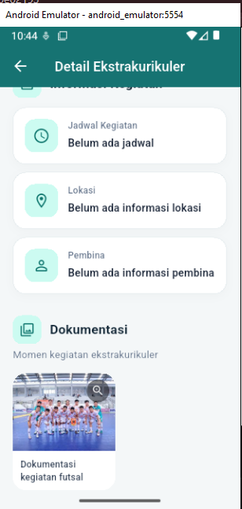

### 10. Dashboard Admin
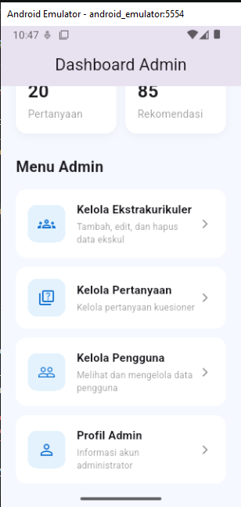

### 11. Kelola Ekstrakurikuler
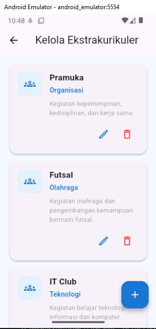

### 12. Kelola Pertanyaan
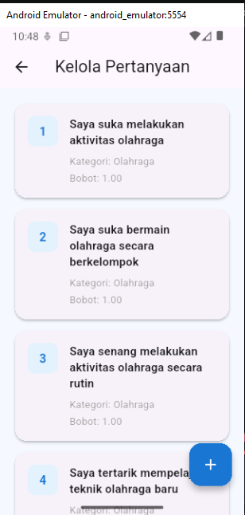

### 13. Halaman Tentang
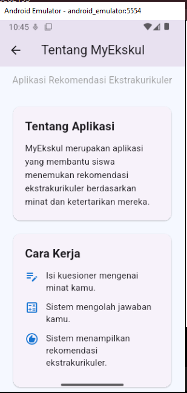
